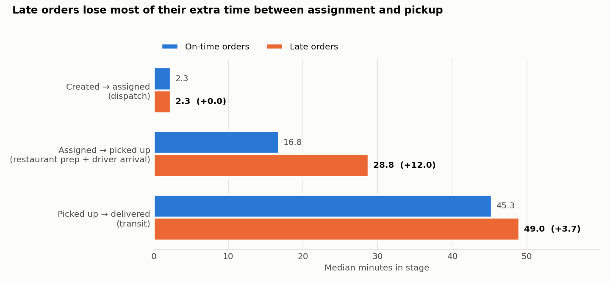
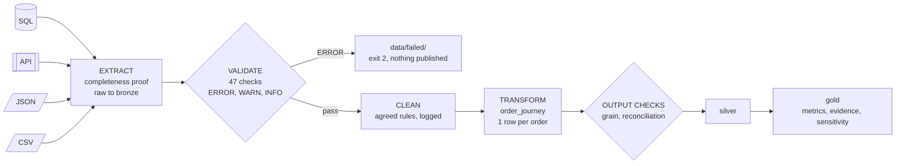

# FlashEats — dependable late-delivery KPI pipeline

**Track A (FlashEats-style)** · FDE Data Foundations, 

> *"Late deliveries are increasing and customers say our ETA is unreliable. Figure out what is happening before we invest in an AI delay-prediction system."*

| | |
|---|---|
| **Problem** | Late deliveries are hurting customer experience. Leadership quotes "56% late" and wants to fund an AI delay predictor |
| **Users / stakeholders** | VP Operations (owns the decision) · Ops & Dispatch (act on delays) · Support Lead · Finance · Data team |
| **Project KPI** | **Reduce late delivery rate**: delivered orders past promised ETA ÷ delivered orders with a recorded delivery time |
| **Decision supported** | *Build the AI predictor now, or fix something first? Where in the workflow should Ops intervene?* |
| **Answer** | **Not yet.** Delay concentrates in an uninstrumented stage (assigned → pickup). Instrument driver arrival, trigger restaurant contact when pickup wait > 25 min, and measure it with this pipeline |

## Results: run_date 2026-08-29 (orders 1–28 Aug 2026)

| # | Metric | Value | Linked to KPI because |
|---|---|---|---|
| M1 | **Late delivery rate** (KPI) | **56.4%** (843 / 1,495) | It is the KPI |
| M2 | Late severity | median **8.0 min** late · p90 22.3 min · 23.3% of deliveries > 10 min late | Shows how bad "late" is, and why Support's >10 min view gives 23% |
| M3 | Stage delay gap (late − on-time, median) | dispatch **+0.0** · assigned→pickup **+12.0** · transit **+3.7** min | Shows *where* to reduce delay |
| M4 | Pickup-wait breach (assigned→pickup > 25 min) | 41.2% of deliveries · **94.4%** of them late vs 30.7% | A leading indicator Ops can act on before the ETA is missed |
| M5 | Intervention coverage of late orders | **27.0%** get any · 24.2% before delivery · 10.5% of interventions happen *after* delivery | Shows whether the current levers reach late orders in time |



Full evidence table with data-trust panel, sensitivity and open issues: [`data/gold/run_date=2026-08-29/evidence_table.md`](data/gold/run_date=2026-08-29/evidence_table.md) · Known / Unknown / Assumption / Limitation: [`docs/known_unknowns.md`](docs/known_unknowns.md)

## The FDE judgement call: which "late"?

Four stakeholders define late differently ([`client_metric_definitions.json`](source_data/files/client_metric_definitions.json)), and the headline swings from **23% to 57%**:

| Definition | Late / denominator | Rate |
|---|---|---|
| **Canonical: > 0 min past promise ÷ delivered with delivery time** | 843 / 1,495 | **56.4%** |
| VP Ops: all delivered orders in denominator | 843 / 1,532 | 55.0% |
| Support Lead: only > 10 min counts | 349 / 1,495 | 23.3% |
| Counterfactual: cancelled orders not excluded | 843 / 1,600 | 52.7% |
| Canonical + back-fill 37 missing delivery times from driver app | 867 / 1,532 | 56.6% |

**Chosen:** the customer's promise (any minute late) over orders we can actually measure. Cancellations are excluded, as Finance asked, and the definition reproduces the client's own outcome labels exactly. The 37 unmeasurable orders are **reported, not back-filled**: the order DB is the system of record, back-filling changes the rate by only 0.2 pp, and quietly fixing it would hide a platform bug. Every alternative is republished on each run (`late_definition_sensitivity.csv`), and the choice is one line in `config/config.yaml`.

## Sources 

| Source | Mode | Grain | Rows | Role |
|---|---|---|---|---|
| Order platform DB (`orders`, `restaurants`, `drivers`, `customers`) | **SQL** | order / entity | 1,603 (1,600 unique) | System of record for the KPI |
| Dispatch service `/dispatch/orders` | **REST API** (paginated, retried) | order | 1,600 | Driver assignment time, reassignment |
| Driver app `driver_events.json` | **Nested JSON** | driver event | 10,035 | Pickup/delivery corroboration, GPS |
| Ops & Support exports: interventions, tickets, restaurant status, app actions, order events, outcomes | **CSV** | event / ticket / action | 202 – 4,955 | Interventions, customer voice, reconciliation |

Question → information → source map, owners, freshness and gaps: [`docs/source_map.md`](docs/source_map.md) · data model: [`docs/data_model.md`](docs/data_model.md)

## Pipeline 



| Dependability property | How | Proof |
|---|---|---|
| Repeatable | One command, parameterised by `--run-date`; trailing 28-day window; config + `.env` outside code | `data/gold/run_date=2026-08-22/` and `=2026-08-29/` |
| Idempotent rerun | Date partitions written to staging then swapped in atomically; rerun **replaces** | `demo_dependability.sh` step 2: 27 files byte-identical |
| Retrieval completeness | SQL vs `COUNT(*)`, CSV vs record count + sha256, JSON vs nested event count, API vs `total_records` | `data/bronze/run_date=2026-08-29/manifest.json` |
| Retries (transient only) | 429/5xx/network: bounded, exponential backoff, honours `retry_after`. 4xx: fail fast | log: page 3 → 500, page 5 → 429, both recovered |
| Validation gate | ERROR → exit 2, report to `data/failed/`, last good output untouched | `--simulate missing_column`; `data/failed/run_date=2026-09-27/` (stale data) |
| Graceful degradation vs hard fail | Dispatch (enrichment) down → columns null, WARN, dependent metrics "n/a", rerun replaces. Order DB (anchor) down → exit 1, nothing published | `--simulate api_down` · `--simulate db_down` |
| Logging for on-call | Per-run-date log with stage, counts, retries, every rule result | [`logs/pipeline_run_date=2026-08-29.log`](logs/pipeline_run_date=2026-08-29.log) |
| Tests | Completeness, gate, anchor-source failure, retry semantics, grain, reconciliation, atomic publish | `pytest`: 10 tests |

Exit codes: `0` published (possibly with warnings) · `1` extract/unexpected failure · `2` stopped by validation gate.

## Run it

```bash
python3 -m venv .venv && source .venv/bin/activate
pip install -r requirements.txt

python run_pipeline.py --run-date 2026-08-29              # normal run (~3 s)
python run_pipeline.py --run-date 2026-08-29 --simulate api_down
python run_pipeline.py --run-date 2026-08-29 --simulate missing_column   # exit 2
python run_pipeline.py --run-date 2026-08-29 --simulate db_down          # exit 1
python run_pipeline.py --run-date 2026-09-27              # stale data → exit 2

python -m pytest -q                                        # 10 tests
PYTHON=python bash scripts/demo_dependability.sh           # full dependability replay (~30 s)

pip install jupyter && jupyter notebook notebooks/         # analysis notebooks (pre-executed)
```

The mock Dispatch API starts automatically on a free port for each run, so its planted failures fire every time. The data covers August 2026, so use run dates 2026-08-02 to 2026-08-30; later dates are correctly rejected as stale.

## Where each class is evidenced

| Class | Skill | Evidence |
|---|---|---|
| 4 | Understand sources | [`docs/source_map.md`](docs/source_map.md): questions → information → systems, owners, grain, freshness, gaps |
| 5 | Retrieve data | [`pipeline/extract.py`](pipeline/extract.py) (SQL, API, JSON, CSV) · bronze manifest · [`notebooks/01`](notebooks/01_sources_retrieval_validation.ipynb) §2–3 |
| 6 | Profile & validate | [`pipeline/validate.py`](pipeline/validate.py) · [`docs/validation_findings.md`](docs/validation_findings.md) · `validation_report.json` · notebook 01 §4–5 |
| 7 | Model workflow | [`pipeline/transform.py`](pipeline/transform.py) · [`docs/data_model.md`](docs/data_model.md) · [`notebooks/02`](notebooks/02_workflow_model_and_metrics.ipynb) · [`pipeline/metrics.py`](pipeline/metrics.py) |
| 8 | Dependable pipeline | [`run_pipeline.py`](run_pipeline.py) · [`config/`](config/) · [`tests/`](tests/) · [`scripts/demo_dependability.sh`](scripts/demo_dependability.sh) · [`logs/`](logs/) |

## Repository layout

```
run_pipeline.py            one-command entry point
config/                    config.yaml (rules, thresholds, late definition) · .env.example
pipeline/                  extract · validate · clean · transform · metrics · report · save · mock_api
api/                       mock Dispatch API (Flask) + its data
source_data/               client inputs as received: flasheats.db, CSV/JSON exports
data/bronze|silver|gold/   date-partitioned outputs (sample partitions committed as evidence)
data/failed/               validation reports for runs the gate stopped
logs/                      one log per run date
notebooks/                 01 sources/retrieval/validation · 02 workflow model & metrics
docs/                      source map · data model · validation findings · known/unknowns · demo script
tests/                     pytest dependability tests
```

Data: FlashEats classroom pack (synthetic). The 430-row `order_interventions.csv` from the classroom pack is used; the Class 8 repo ships a different 260-row version (matching the 260 intervention events in `order_events.csv`), and that discrepancy is itself a finding (see source map).
