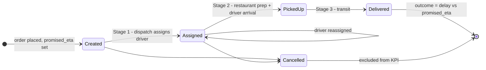
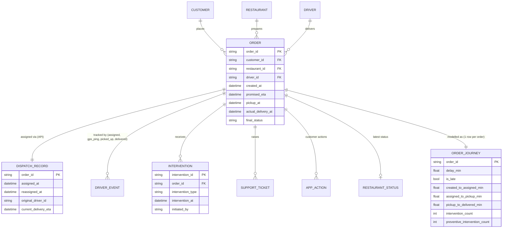
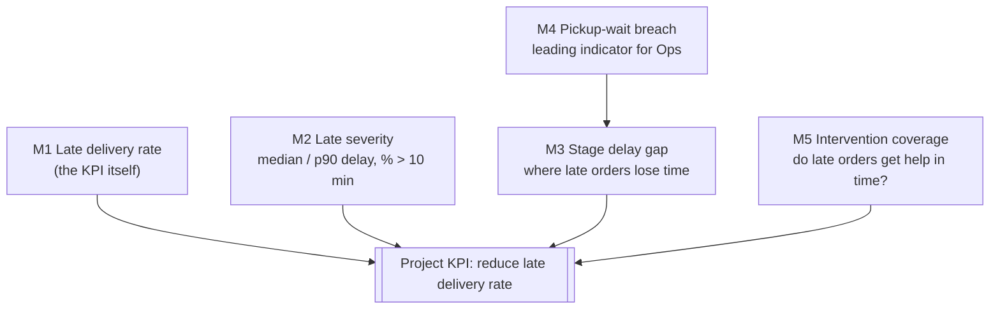

# Workflow & data model 

Raw systems are organised **by source**. The model reorganises them **around the order's journey**:
source tables → business journey → workflow model → metrics → project KPI.

## Entities, events, states

| Kind | Items | Where it comes from |
|---|---|---|
| **Entities** (persist, get updated) | Order, Customer, Restaurant, Driver, Support ticket | Order DB, CRM, merchant/fleet tables, support desk |
| **Events** (happen at a time) | order created · driver assigned · (driver reassigned) · picked up · GPS ping · delivered · intervention · ticket opened · ETA viewed | Order DB, Dispatch API, driver app, intervention log, app analytics |
| **States** (where it is now) | created → assigned → picked up → delivered / cancelled | Derived from events (`final_status`, `dispatch_status`) |
| **Interactions** (customer-side) | ETA viewed, support opened, cancel attempted, ticket | `customer_app_actions.csv`, `support_tickets.csv` |
| **Interventions** (company-side) | DRIVER_REASSIGNMENT, RESTAURANT_CONTACT, PRIORITY_DISPATCH, CUSTOMER_CREDIT | `order_interventions.csv` |
| **Outcome** | on time / late (delay > 0) / cancelled / unmeasurable | Derived: `actual_delivery_at − promised_eta` |

## Order lifecycle (state machine) and the stages we measure

Stage 2 has **no "driver arrived at restaurant" event**, so prep time and driver travel can't be separated.

Interventions can land at any state. They are **preventive** if they happen before `actual_delivery_at` and **after-the-fact** otherwise.

## Relational model

## Grain rule

Every one-to-many source is **aggregated to `order_id` before the left join**. Joining events and interventions directly onto 1,600 orders produces 4,955 rows (3.1× fan-out; see notebook 02). The pipeline enforces this with output check **O01**: the journey must have exactly one row per window order, or the run stops.

## `order_journey` (silver) column groups

| Group | Columns | Source |
|---|---|---|
| Order facts | `order_id, customer_id, restaurant_id, driver_id, created_at, promised_eta, pickup_at, actual_delivery_at, final_status, distance_km_estimate, traffic_bucket, weather_bucket` | Order DB |
| Restaurant | `restaurant_cuisine, restaurant_manual_status_updates, restaurant_last_status, restaurant_status_updated_at` | DB + status export |
| Dispatch | `assigned_at, reassigned_at, was_reassigned, original_driver_id, current_delivery_eta, eta_model_version, dispatch_available` | Dispatch API |
| Driver app | `app_picked_up_at, app_delivered_at, gps_pings_total, gps_pings_in_transit` | driver_events.json |
| Interventions | `intervention_count, preventive_intervention_count, intervention_types, first_intervention_at` | Intervention log |
| Customer | `ticket_count, ticket_categories, first_ticket_at, eta_views, support_opened, cancel_attempts` | Support + app |
| Outcome & state | `is_delivered, is_cancelled, is_measurable, delay_min, is_late, is_late_over_10min` | Derived |
| Stages | `promised_duration_min, created_to_assigned_min, assigned_to_pickup_min, pickup_to_delivered_min, pickup_wait_breach` | Derived (null when that stage's chronology is invalid) |
| Data-quality flags | `dq_unmeasurable_delivery, dq_delivery_recoverable_from_driver_app, dq_delivery_before_pickup, dq_promised_before_created, dq_pickup_before_assigned, dq_no_transit_gps` | Validation rules, kept on the row, never dropped |

## Metrics → KPI

