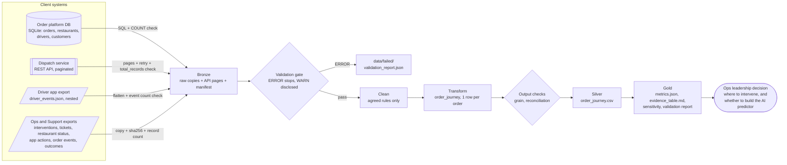

# Source map 

Start from the question, not the tables: **business question → information needed → system of record**.

## Question → information → source

| # | Business question | Information needed | System of record | Why this source (and not another) |
|---|---|---|---|---|
| Q1 | How many deliveries are late? | `promised_eta`, `actual_delivery_at`, `final_status` | **Order platform DB** (`orders`) | Creates and owns the order and its promise. `order_outcomes.csv` is a derived export, used only to reconcile |
| Q2 | Where in the workflow is time lost? | created → assigned → picked up → delivered | Order DB (`created_at`, `pickup_at`, `actual_delivery_at`) + **Dispatch API** (`assigned_at`) | Only dispatch knows when a driver was assigned |
| Q3 | Was the restaurant ready / did the driver wait? | ready / handed-off time, driver arrival | Restaurant status export (partial) | ⚠️ **Gap:** no driver-arrived-at-restaurant event anywhere |
| Q4 | Did the driver move after pickup? | GPS pings between pickup and delivery | **Driver app** (`driver_events.json`) | Only telemetry source; 9 delivered orders have no in-transit ping |
| Q5 | Did Ops/Support intervene, and in time? | intervention type, time, initiator | **Intervention log** (`order_interventions.csv`) | Has initiator + reason. `order_events.csv` has a *different* intervention stream (overlap 75 orders) |
| Q6 | What did customers experience? | tickets, ETA views, support opens | Support desk (`support_tickets.csv`), app analytics (`customer_app_actions.csv`) | Customer voice; used to corroborate, not to define late |
| Q7 | Which definition of "late" is the KPI? | stakeholder definitions | `client_metric_definitions.json` | ⚠️ **Gap:** "No canonical KPI owner is formally documented" |

## Source inventory

Owners are the teams that *create and change* the object. The client didn't document owners, so they are marked as assumptions to confirm.

| Source | Retrieval mode | Owner (assumed) | Grain | Rows | Freshness | Trust notes |
|---|---|---|---|---|---|---|
| `flasheats.db` → `orders` | **SQL** (SQLite, parameterised by date window) | Order platform eng | 1 row per order *(violated: 3 duplicates)* | 1,603 (1,600 unique) | Operational, up to 2026-08-28 23:33 | System of record for KPI. 37 delivered orders lack `actual_delivery_at` |
| `flasheats.db` → `restaurants`, `drivers`, `customers` | **SQL** | Merchant ops / fleet / CRM | 1 row per entity | 60 / 120 / 900 | Slowly changing | Only `customer_id` extracted: name/email not needed (data minimisation) |
| Dispatch service `/dispatch/orders` | **REST API** (paginated, 200/page) | Dispatch eng | 1 row per order | 1,600 | Live | Transient 500/429 → retried. Only source of `assigned_at` and reassignment |
| `driver_events.json` | **Nested JSON file** (driver → events[]) | Driver app team | 1 row per driver event after flattening | 10,035 events / 120 drivers | Daily export | Agrees with order DB delivery time to the second on 1,495 orders; has delivery evidence for all 37 "unknown" orders |
| `order_interventions.csv` | **CSV file** | Ops + Support | 1 row per intervention | 430 | Daily export | Chosen as intervention record (initiator + reason) |
| `order_events.csv` | **CSV file** | Order platform | 1 row per lifecycle event | 4,955 | Daily export | Its 260 intervention events disagree with the 430-row log: an unresolved **source conflict** |
| `support_tickets.csv` | **CSV file** | Support | 1 row per ticket | 202 (1 dup, 3 without order_id) | Daily export | Free-text categories need normalising |
| `restaurant_status.csv` | **CSV file** | Merchant ops (23 of 60 restaurants update status manually) | last status per order | 502 (2 dup) for 500 orders | Snapshot | Only latest status, no history → can't time prep |
| `customer_app_actions.csv` | **CSV file** | App analytics | 1 row per app action | 2,365 | Daily export | ETA views / support opens / cancel attempts |
| `order_outcomes.csv` | **CSV file** | Data team (derived) | 1 row per order | 1,600 | Derived | **Not a source of truth**, used to reconcile. Pipeline reproduces its 843 late labels exactly |
| `restaurants.csv`, `customer_interactions.csv` | — (not ingested) | — | — | — | — | Not ingested: `restaurants.csv` has identical content to the DB table; `customer_interactions.csv` overlaps tickets + app actions (ingesting both would double count) |

Retrieval modes used: **SQL, REST API, CSV files, nested JSON**. Completeness proof for each is in `data/bronze/run_date=*/manifest.json`.

## How the sources flow into the pipeline

## Important gaps (they change the solution design)

1. **No "driver arrived at restaurant" event.** Assigned → pickup mixes restaurant prep with driver travel, and that is the stage where late orders lose the most time.
2. **37 delivered orders have no delivery time** in the system of record, though the driver app has one for each.
3. **Two intervention systems disagree** (430 vs 260 records, 75 orders overlap), so intervention metrics carry a caveat.
4. **No KPI owner** for "late", so four definitions are in circulation (see `late_definition_sensitivity.csv`).
5. **Restaurant status is a last-value snapshot**, with no history, so prep time can't be measured.
